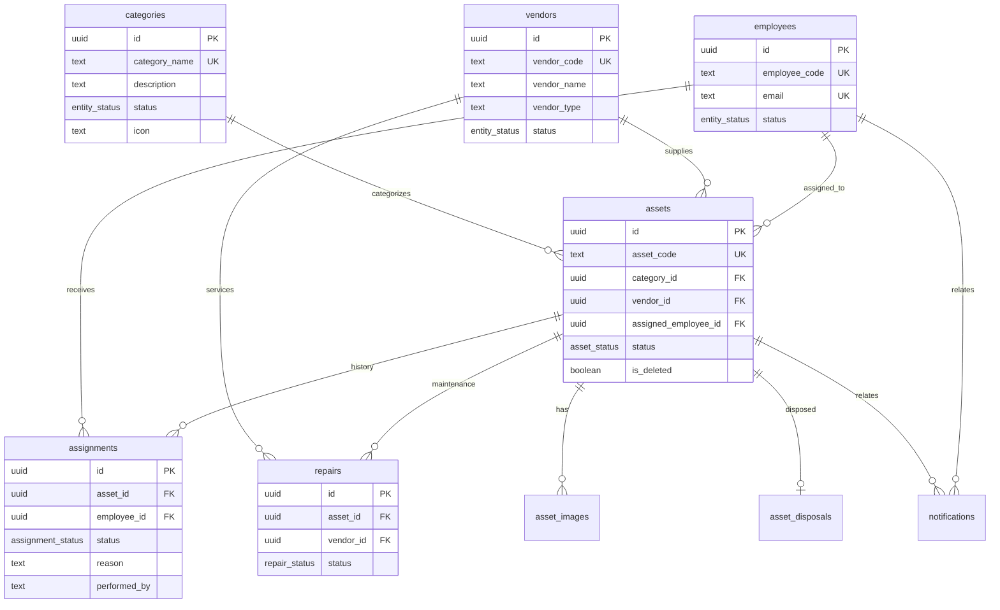

# 05 Data, API, and Contract Specification — goAI Asset Management

> **Sources:** `src/lib/mock-db.ts`, `src/integrations/supabase/types.ts`, sidebar module routes (`dashboard`, `assets`, `employees`, `categories`, `vendor-management`), APDM `T05_DATA_MODEL_TEMPLATE.md`  
> **Templates used:** `T05_DATA_MODEL_TEMPLATE`, `T05_API_CONTRACT_TEMPLATE`, `T05_VALIDATION_RULES_TEMPLATE`, `T05_EVENT_CONTRACT_TEMPLATE`, `T05_MIGRATION_MAPPING_TEMPLATE`

## 1. Platforms in Scope (from Phase 00)

| Platform | In scope? | Source |
|---|---|---|
| Web | Yes | React + TanStack Router SPA |
| Mobile | No | — |
| Backend API (surface) | Yes | Supabase PostgREST + RLS |

## 2. Delivery Tracks

| Track | Required? | Why |
|---|---|---|
| Frontend | Yes | Web UI consumes data via `MockDB` facade |
| Mobile | No | — |
| Backend | Yes | Supabase PostgreSQL + Auth |
| Data | Yes | Persistent relational schema for all modules |
| Infra/DevOps | Yes | Supabase migrations via Lovable Cloud |
| QA | Yes | Schema supports acceptance scenarios |
| Security | Yes | RLS + role-based access (`administrator`, `it_team`, `employee`) |
| AI/Automation | No | — |

## 3. Data Ownership Summary

| Data domain | Owner | Source of truth | Consumers (Web) |
|---|---|---|---|
| Categories | Data layer | `categories` table | Categories module, Assets (FK), Dashboard (view) |
| Vendors | Data layer | `vendors` table | Vendor Management, Assets (FK), Repairs (FK) |
| Employees | Data layer | `employees` table | Employees module, Assets (FK), Assignments (FK) |
| Assets | Data layer | `assets` table | Assets module, Dashboard (view), Assignments, Repairs |
| Assignments | Data layer | `assignments` table | Asset/Employee history, Dashboard recent activity |
| Repairs | Data layer | `repairs` table | Repair history, Dashboard open tickets |
| Asset images | Data layer | `asset_images` table | Asset detail images tab |
| Disposals | Data layer | `asset_disposals` table | Dispose workflow audit |
| Notifications | Data layer | `notifications` table | Notification center |
| Activity logs | Data layer | `activity_logs` table | Audit trail, Dashboard activity feed |
| Dashboard metrics | Derived | SQL views (no storage) | Dashboard module |
| Auth / profiles | Supabase Auth | `profiles`, `user_roles` | Session, RBAC |

**Design principle:** Dashboard has **no persistent table**. All dashboard widgets query normalized source tables or read-only views.

## 4. Entity Model

| Entity | Store | Module | Primary Key | Relationships |
|---|---|---|---|---|
| Category | `categories` | Categories | `id` (UUID) | 1:N → `assets` |
| Vendor | `vendors` | Vendor Management | `id` (UUID) | 1:N → `assets`, `repairs` |
| Employee | `employees` | Employees | `id` (UUID) | 1:N → `assets`, `assignments` |
| Asset | `assets` | Assets | `id` (UUID) | N:1 → `categories`, `vendors`, `employees`; 1:N → `assignments`, `repairs`, `asset_images`, `asset_disposals` |
| Assignment | `assignments` | Assets / Employees | `id` (UUID) | N:1 → `assets`, `employees` |
| Repair | `repairs` | Assets | `id` (UUID) | N:1 → `assets`, `vendors` |
| AssetImage | `asset_images` | Assets | `id` (UUID) | N:1 → `assets` |
| AssetDisposal | `asset_disposals` | Assets | `id` (UUID) | 1:1 → `assets` |
| Notification | `notifications` | System | `id` (UUID) | N:1 → `auth.users`, optional FKs to `assets`, `employees` |
| ActivityLog | `activity_logs` | System | `id` (UUID) | Polymorphic `entity_type` + `entity_id` |
| DashboardSummary | `dashboard_summary` (view) | Dashboard | — | Aggregates from `assets`, `employees`, `repairs` |
| DashboardAssetsByCategory | `dashboard_assets_by_category` (view) | Dashboard | — | Joins `assets` + `categories` |
| DashboardAssetsByStatus | `dashboard_assets_by_status` (view) | Dashboard | — | Groups `assets` |
| DashboardRecentActivity | `dashboard_recent_activity` (view) | Dashboard | — | Joins `assignments` + `assets` + `employees` |
| DashboardWarrantyExpiring | `dashboard_warranty_expiring` (view) | Dashboard | — | Filters `assets` |
| DashboardOpenRepairs | `dashboard_open_repairs` (view) | Dashboard | — | Joins `repairs` + `assets` |

### Entity-Relationship Diagram

## 5. Field Dictionary

### 5.1 Categories

| Field | Type | Required | Validation | Notes |
|---|---|---|---|---|
| id | UUID | Yes (server) | PK, `gen_random_uuid()` | |
| category_name | TEXT | Yes | Unique, non-empty | |
| description | TEXT | No | Max practical length | UI description |
| status | `entity_status` | Yes | `active` \| `inactive` | Default `active` |
| icon | TEXT | No | Lucide icon key | e.g. `laptop`, `monitor` |
| created_at | TIMESTAMPTZ | Yes | ISO-8601 | |
| updated_at | TIMESTAMPTZ | Yes | ISO-8601 | Trigger-maintained |

### 5.2 Vendors

| Field | Type | Required | Validation | Notes |
|---|---|---|---|---|
| id | UUID | Yes | PK | |
| vendor_code | TEXT | Yes | Unique, `VND-####` | Auto-sequence |
| vendor_name | TEXT | Yes | Non-empty | |
| contact_person | TEXT | No | | |
| email | TEXT | No | Email format (app-level) | |
| phone | TEXT | No | | |
| office_address | TEXT | No | | Replaces legacy `address` |
| vendor_type | TEXT | No | Enum list in app | Hardware Supplier, etc. |
| status | `entity_status` | Yes | Default `active` | |
| website | TEXT | No | URL | |
| gst_number | TEXT | No | | |
| notes | TEXT | No | | |

### 5.3 Employees

| Field | Type | Required | Validation | Notes |
|---|---|---|---|---|
| id | UUID | Yes | PK | |
| employee_code | TEXT | Yes | Unique | `EMP-####` |
| name | TEXT | Yes | Non-empty | |
| email | TEXT | Yes | Unique | |
| phone | TEXT | No | | |
| department | TEXT | No | | |
| designation | TEXT | No | | |
| location | TEXT | No | | |
| manager | TEXT | No | | Legacy field retained |
| status | `entity_status` | Yes | Default `active` | |
| user_id | UUID | No | FK → `auth.users` | Links portal user |

### 5.4 Assets

| Field | Type | Required | Validation | Notes |
|---|---|---|---|---|
| id | UUID | Yes | PK | |
| asset_code | TEXT | Yes | Unique, `AST-####` | Auto-sequence |
| asset_name | TEXT | Yes | Non-empty | |
| category_id | UUID | No | FK → `categories` | SET NULL on delete |
| brand | TEXT | No | | |
| model | TEXT | No | | |
| serial_number | TEXT | No | | |
| purchase_date | DATE | No | ISO date | |
| purchase_cost | NUMERIC(12,2) | No | ≥ 0 | Legacy USD field |
| purchase_cost_inr | NUMERIC(14,2) | No | ≥ 0 | Primary cost in UI |
| invoice_number | TEXT | No | | |
| vendor_id | UUID | No | FK → `vendors` | SET NULL on delete |
| warranty_start | DATE | No | | |
| warranty_expiry | DATE | No | | Warranty alerts |
| status | `asset_status` | Yes | State machine | Includes `inactive` |
| assigned_employee_id | UUID | No | FK → `employees` | Denormalized current assignee |
| location | TEXT | No | | |
| remarks | TEXT | No | | |
| is_deleted | BOOLEAN | Yes | Default `false` | Soft delete / archive |
| deleted_at | TIMESTAMPTZ | No | Set on soft delete | |

### 5.5 Assignments (assignment, unassignment, disposal, deactivation history)

| Field | Type | Required | Validation | Notes |
|---|---|---|---|---|
| id | UUID | Yes | PK | |
| asset_id | UUID | Yes | FK → `assets` CASCADE | |
| employee_id | UUID | No | FK → `employees` CASCADE | NULL for disposal/deactivate |
| assigned_date | DATE | Yes | | |
| expected_return_date | DATE | No | | |
| returned_date | DATE | No | | |
| status | `assignment_status` | Yes | Extended enum | `assigned`, `returned`, `unassigned`, `disposed`, `inactive`, etc. |
| notes | TEXT | No | Remarks | |
| reason | TEXT | No | Unassign/dispose reason | |
| performed_by | TEXT | No | Actor display name | |

### 5.6 Repairs

| Field | Type | Required | Validation | Notes |
|---|---|---|---|---|
| id | UUID | Yes | PK | |
| asset_id | UUID | Yes | FK → `assets` CASCADE | |
| vendor_id | UUID | No | FK → `vendors` | |
| issue | TEXT | Yes | Default from unassign | |
| repair_cost | NUMERIC(12,2) | No | ≥ 0 | |
| expected_return_date | DATE | No | | |
| actual_return_date | DATE | No | | |
| repair_notes | TEXT | No | | |
| unassign_reason | TEXT | No | | Links to unassign flow |
| status | `repair_status` | Yes | `in_progress`, `completed`, `cancelled` | |
| repair_date | DATE | Yes | Default today | |
| completed_at | TIMESTAMPTZ | No | | |

### 5.7 Notifications

| Field | Type | Required | Validation | Notes |
|---|---|---|---|---|
| id | UUID | Yes | PK | |
| user_id | UUID | Yes | FK → `auth.users` | Per-user inbox |
| type | `notification_type` | Yes | asset, assignment, repair, warranty, employee, system | |
| title | TEXT | Yes | | |
| message | TEXT | Yes | | |
| is_read | BOOLEAN | Yes | Default `false` | |
| related_asset_id | UUID | No | FK → `assets` SET NULL | |
| related_employee_id | UUID | No | FK → `employees` SET NULL | |
| created_at | TIMESTAMPTZ | Yes | | |

### 5.8 Activity Logs

| Field | Type | Required | Validation | Notes |
|---|---|---|---|---|
| id | UUID | Yes | PK | |
| entity_type | TEXT | Yes | asset, employee, assignment, repair, category, vendor | |
| entity_id | UUID | Yes | | Polymorphic reference |
| action | TEXT | Yes | created, updated, assigned, unassigned, disposed, deactivated, repaired | |
| description | TEXT | No | Human-readable | |
| performed_by | TEXT | No | | |
| metadata | JSONB | No | | Extensible payload |
| created_at | TIMESTAMPTZ | Yes | | |

## 6. API Contract (Supabase PostgREST — canonical)

| Resource | Method | Consumers | Path / Table | Roles (mutate) | Idempotent? |
|---|---|---|---|---|---|
| Categories | GET/POST/PATCH/DELETE | Web | `categories` | admin, it_team | PATCH yes |
| Vendors | GET/POST/PATCH/DELETE | Web | `vendors` | admin, it_team | PATCH yes |
| Employees | GET/POST/PATCH/DELETE | Web | `employees` | admin, it_team | PATCH yes |
| Assets | GET/POST/PATCH/DELETE | Web | `assets` | admin, it_team | PATCH yes |
| Assignments | GET/POST/PATCH | Web | `assignments` | admin, it_team | POST with client UUID |
| Repairs | GET/POST/PATCH | Web | `repairs` | admin, it_team | PATCH yes |
| Asset images | GET/POST/DELETE | Web | `asset_images` | admin, it_team | — |
| Notifications | GET/PATCH/DELETE | Web | `notifications` | owner + admin | mark read |
| Activity logs | GET/POST | Web | `activity_logs` | insert: admin/it; read: admin/it | append-only |
| Dashboard summary | GET | Web | `dashboard_summary` | all authenticated | read-only view |
| Dashboard by category | GET | Web | `dashboard_assets_by_category` | all authenticated | read-only view |
| Dashboard by status | GET | Web | `dashboard_assets_by_status` | all authenticated | read-only view |
| Dashboard activity | GET | Web | `dashboard_recent_activity` | all authenticated | read-only view |
| Dashboard warranty | GET | Web | `dashboard_warranty_expiring` | all authenticated | read-only view |
| Dashboard repairs | GET | Web | `dashboard_open_repairs` | all authenticated | read-only view |

**Integration note:** The existing `MockDB` synchronous API is preserved. `src/lib/db/supabase-persistence.ts` hydrates and persists the in-memory cache without UI changes.

## 7. Offline / Sync

N/A — Web-only application. Supabase client uses online session with localStorage auth persistence.

## 8. Client Field Mapping (MockDB ↔ PostgreSQL)

| MockDB field | DB column | Transform |
|---|---|---|
| `office_address` | `office_address` | Direct |
| `purchase_cost_inr` | `purchase_cost_inr` | Direct |
| `isDeleted` | `is_deleted` | camelCase ↔ snake_case |
| `deleted_at` | `deleted_at` | Direct |
| Assignment `status: "assigned"` | `assignment_status.assigned` | Enum |
| Assignment `employee_id: ""` | `NULL` | Empty string → NULL |
| Repair `repair_notes` | `repair_notes` | Direct |
| Repair `completed_at` | `completed_at` | Direct |
| Notification `createdAt` | `created_at` | camelCase ↔ snake_case |
| Notification `isRead` | `is_read` | camelCase ↔ snake_case |
| Notification `relatedAssetId` | `related_asset_id` | camelCase ↔ snake_case |

## 9. Event Contract

| Event | Producer | Consumer | Payload | Persistence |
|---|---|---|---|---|
| asset.created | MockDB.addAsset | NotificationEvents | asset id, name | `activity_logs` + `notifications` |
| asset.assigned | MockDB.assignAsset | NotificationEvents | asset, employee | `assignments` + `activity_logs` |
| asset.unassigned | MockDB.unassignAsset | NotificationEvents | asset, employee, reason | `assignments` + `activity_logs` |
| asset.sent_for_repair | MockDB.unassignAsset | NotificationEvents | asset id | `repairs` + `activity_logs` |
| asset.disposed | MockDB.disposeAsset | — | reason, date | `assignments` + `asset_disposals` |
| asset.deactivated | MockDB.deactivateAsset | — | remarks | `assignments` + `activity_logs` |
| repair.completed | MockDB.completeRepair | NotificationEvents | asset id | `repairs` + `activity_logs` |
| warranty.expiring | Notification center check | NotificationEvents | asset id, days | `notifications` (deduped) |

## 10. Validation Rules

| Entity | Rule | Error |
|---|---|---|
| Category | Cannot delete if linked assets exist | `LINKED_ASSETS` |
| Vendor | Cannot delete if linked assets exist | `LINKED_ASSETS` |
| Employee | Cannot delete if assigned assets exist | `ASSIGNED_ASSETS` |
| Asset | Cannot assign if status is `disposed` or `inactive` | Business rule in MockDB |
| Asset | Cannot dispose while assigned | Unassign first |
| Asset | `asset_code`, `employee_code`, `vendor_code` unique | DB constraint |
| Assignment | `employee_id` required for assign/unassign events | NULL only for dispose/deactivate |
| Warranty | Expiry alert window = 90 days | Dashboard + notification dedup |

## 11. Indexing Strategy

| Table | Index | Purpose |
|---|---|---|
| `assets` | `(status)` WHERE `NOT is_deleted` | Dashboard status counts |
| `assets` | `(category_id)` WHERE `NOT is_deleted` | Category filtering |
| `assets` | `(assigned_employee_id)` | Employee asset lookup |
| `assets` | `(warranty_expiry)` WHERE `NOT is_deleted` | Warranty expiry widget |
| `assignments` | `(asset_id, created_at DESC)` | Asset history |
| `assignments` | `(employee_id, created_at DESC)` | Employee history |
| `repairs` | `(asset_id, status)` | Open repair tickets |
| `notifications` | `(user_id, is_read, created_at DESC)` | Inbox queries |
| `activity_logs` | `(entity_type, entity_id, created_at DESC)` | Audit queries |

## 12. Phase Exit Criteria

- [x] One canonical data model aligned to all five sidebar modules
- [x] Dashboard uses views only (no duplicate storage)
- [x] FK relationships: Assets → Employees, Categories, Vendors
- [x] Normalized schema with extension points (`metadata` JSONB on activity logs)
- [x] Migration SQL created with RLS, indexes, constraints
- [x] MockDB persistence adapter preserves existing UI API
- [x] Field mapping documented for brownfield MockDB → Supabase transition
